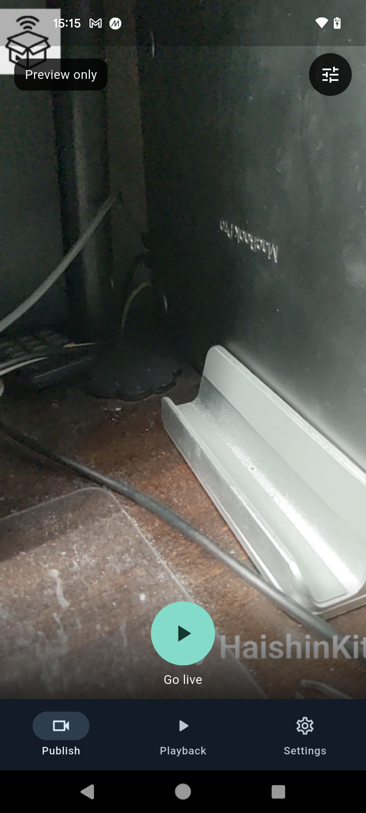
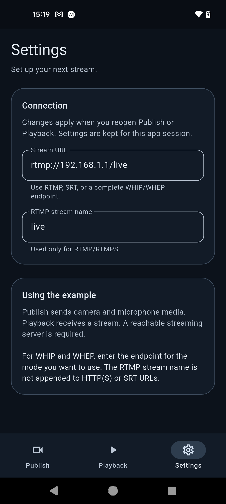
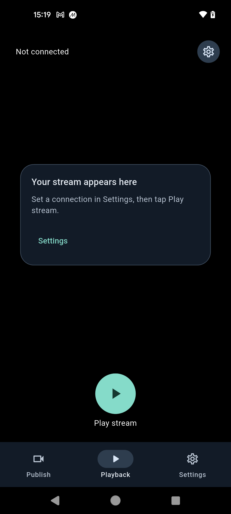

# 📡 [HaishinKit](https://haishinkit.com/) Plugin

[](https://github.com/HaishinKit/HaishinKit.dart/actions/workflows/dart.yml)
[](https://pub.dev/packages/haishin_kit)
[](#-installation)
[](#-installation)
[](LICENSE)

A Flutter interface to HaishinKit's native streaming libraries for Android, iOS,
and macOS. Capture, compose, preview, publish, and play audio/video with RTMP,
RTMPS, SRT, WHIP, and WHEP.

[API reference](https://docs.haishinkit.com/dart/latest/) ·
[pub.dev](https://pub.dev/packages/haishin_kit) · [Example app](example/README.md)

## 🎨 Features

- Camera and microphone capture through a common `MediaMixer` interface.
- RTMP/RTMPS and SRT publishing/playback, WHIP publishing, and WHEP playback.
- Text, image, and video compositions, snapshots, and ScreenObject editing APIs.
- Native video textures for Flutter previews and playback.
- OS video encoder selection, including AV1/VP8/VP9 for Android RTMP.
- HLG capture and native HDR previews on supported iOS and Android devices.
- A common `StreamSession` lifecycle across supported platforms.

## 📦 Installation

Add the published package to your app's `pubspec.yaml`:

```yaml
dependencies:
  haishin_kit: ^0.19.1
```

```sh
flutter pub get
```

Use **Flutter 3.44+** and **Dart 3.12+**. Platform requirements:

| Platform | Minimum |
|---|---|
| Android | Android 7 / API 24 with Flutter 3.44; compile SDK 37+ |
| iOS | iOS 15; Xcode 26+ |
| macOS | macOS 12; Xcode 26+ |

The Android app minimum follows Flutter's SDK minimum; the native bridge declares
API 23. Android WHIP audio publishing requires an Opus encoder, provided by
Android 10+.

Apple builds use Swift Package Manager. Enable it before building:

```sh
flutter config --enable-swift-package-manager
```

See the [integration guide in the library documentation](https://github.com/HaishinKit/HaishinKit.dart/blob/main/lib/haishin_kit.dart)
for permissions, Android build properties, Apple setup, and session lifecycle.

## 📚 Documentation

Use the generated [dartdoc reference](https://docs.haishinkit.com/dart/latest/)
for capture, composition, stream sessions, and protocol integration.

The install example targets **0.19.1**. The `main` branch contains the
refreshed example and may include changes ahead of the published package or API
reference; use a matching release tag when working with a published version.

## 🐾 Examples

The [Flutter sample](example/README.md) demonstrates camera publishing, playback,
text/image overlays, optional picture-in-picture camera capture, and touch editing.
Its studio interface keeps the preview clear, with camera tools in a bottom sheet.

Flutter example running on Android (English, Pixel 5a):

<p>
  
  
  
</p>

From a repository checkout:

```sh
cd example
flutter pub get
flutter run
```

A reachable streaming server is required for publishing/playback. See the
[example guide](example/README.md) for endpoint settings and platform setup.

## 🌏 Native projects

- [HaishinKit.swift](https://github.com/HaishinKit/HaishinKit.swift) — Apple platforms.
- [HaishinKit.kt](https://github.com/HaishinKit/HaishinKit.kt) — Android.

## 💖 Support

Community discussion is open to everyone following the
[code of conduct](https://github.com/HaishinKit/HaishinKit.dart?tab=coc-ov-file). Technical support is available to
contributors, academic researchers, and [sponsors](https://github.com/sponsors/shogo4405).
The $50/month sponsorship tier includes priority support through Issues/Discussions.

## 📜 License

[BSD 3-Clause](LICENSE). Native dependencies carry their own licenses;
see the native projects for third-party notices.
