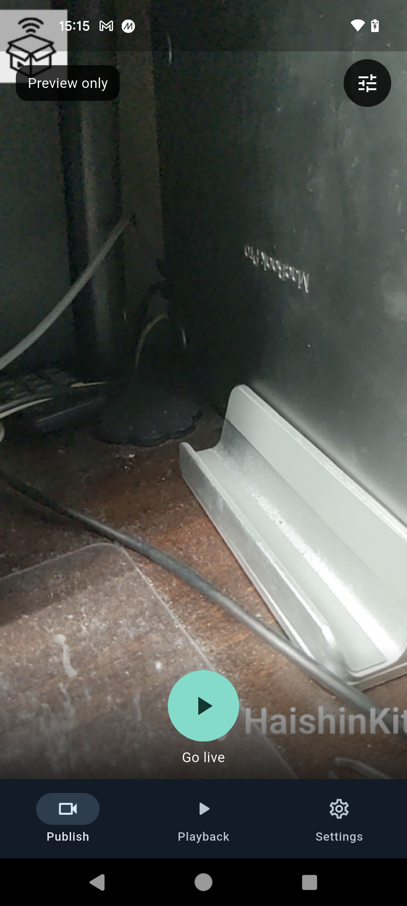
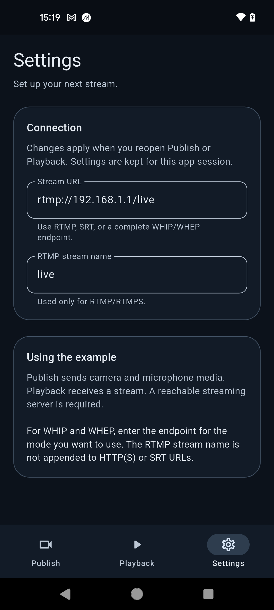
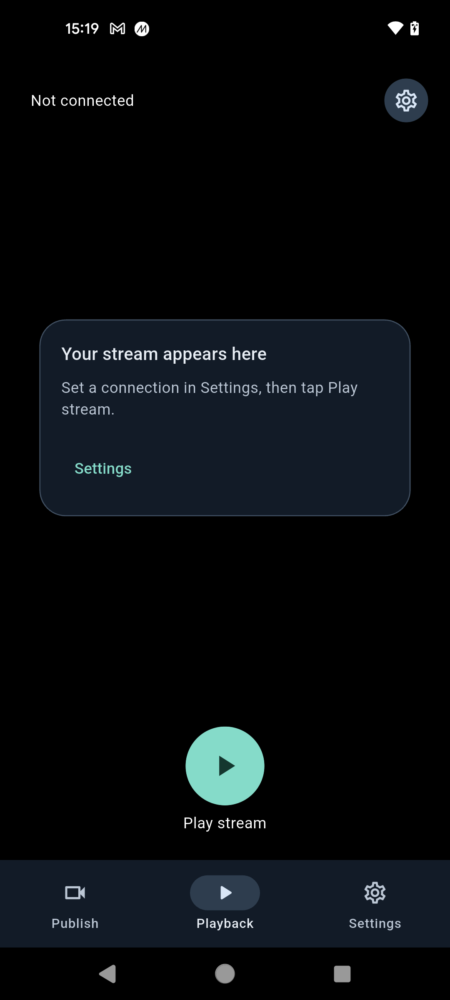

# 📡 HaishinKit Flutter example

[](android/app/build.gradle.kts)
[](ios/Runner.xcodeproj/project.pbxproj)
[](../LICENSE)

A camera-publishing and stream-playback example for the local HaishinKit plugin.
It uses the same navy-and-teal studio direction as the Android sample, with a
clear camera preview, compact controls, and English/Japanese labels.

## 🎨 Screens

Flutter example on Android, shown in English on a Pixel 5a:

<p>
  
  
  
</p>

## 🛠️ Run

Use Flutter **3.44+** and Dart **3.12+**, matching the plugin requirements.
The Android example follows Flutter's minimum SDK (API 24 with Flutter 3.44);
the iOS example targets iOS 15+. Configure the platform SDKs before building.
Apple builds use Swift Package Manager. iOS simulator builds require arm64
(Apple Silicon), matching the native SRT/RTC binary dependencies.

```sh
cd example
flutter pub get
flutter run
```

This example depends on the repository checkout through `path: ../`. For a
published app, use the [pub.dev package](https://pub.dev/packages/haishin_kit).

## 🎥 Publish

1. Open **Settings** and enter a reachable stream URL. Enter a separate stream
   name only for RTMP/RTMPS; SRT and HTTP(S) endpoints are used as entered.
2. Open **Publish** and allow camera/microphone access.
3. Open **Camera tools** to select a camera. Tap **Go live** to connect, then
   **Stop stream** to disconnect. Connection errors remain visible on screen.

The preview retains the sample's text/image overlays, an optional second camera,
and touch-based ScreenObject editing. Camera selection lives in a bottom sheet
so the default view stays clear. Enable **Second camera** in that panel to add
a picture-in-picture camera. Native camera availability varies by device.

In **Camera tools → Scene**, use **Add sample video** to loop the same video
asset as the Swift example. Drag or resize it in the preview. Only the video
track is rendered; its audio is not mixed.

**Save scene** packages the actual composition and its local media into a
portable `.scene` file. **Load scene** replaces the composition while disconnected
and retains its saved canvas dimensions when publishing. Files/media are limited
to 32 MiB. Capture devices and connection/codec settings are not saved; track zero
continues to use the current camera. Unknown platform-specific objects remain
invisible and survive export. Temporary media is released when leaving Publish.

## ▶️ Playback

Set the stream URL in **Settings**, open **Playback**, and tap **Play stream**.
Use the endpoint for the desired mode: WHIP publishes and WHEP plays back; their
URLs are not inferred from each other. A streaming server is required.

## 📱 Layout

Phones use three labelled bottom destinations. Wider windows use a navigation
rail, and settings scroll with large text or when the keyboard is visible.
Leaving a page releases its capture/session resources; settings are retained
for the current app session.

The launcher uses the same HaishinKit artwork as the Swift and Android samples.
The example exposes its existing Flutter APIs; it does not add native-only
recording, filters, or screen-sharing controls.

## ✅ Check

```sh
flutter analyze
flutter test
flutter build apk --debug --target-platform android-arm64
```

See the [generated API reference](https://docs.haishinkit.com/dart/latest/) for
library APIs and protocol integration.
